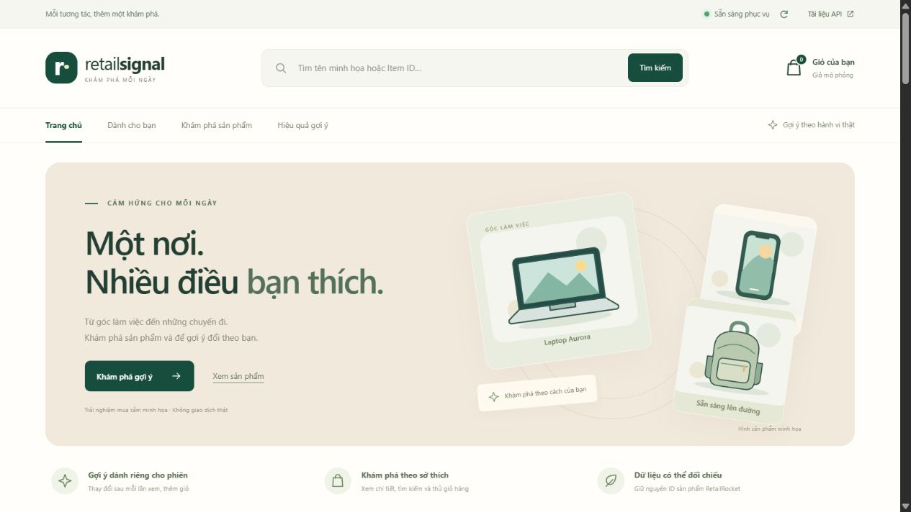

# RetailRocket — Big Data Phase 1–7

Dự án gợi ý sản phẩm từ hành vi xem, thêm giỏ và mua hàng trong dữ liệu RetailRocket. Bản hiện tại có giao diện cửa hàng, tìm kiếm, 19 danh mục minh họa, giỏ mô phỏng và nút **Mua ngay** ngay trên thẻ sản phẩm.



## Tải bản demo đầy đủ

**[Mở Release và tải `big_data_update_2_storefront_v2.zip`](https://github.com/bluejames1106/big-data-retailrocket/releases/tag/storefront-v2)**

ZIP gồm toàn bộ mã nguồn, `events.csv`, model đã huấn luyện và các SQLite cần để chạy demo. Mã nguồn để đọc và chỉnh sửa nằm ở gốc repository này; các tệp dữ liệu/model lớn được lưu trong ZIP đính kèm Release.

SHA-256 của ZIP:

```text
0bcab83532482f9934078c525c2be51eb44ded50aae1a8f2f8fc2e0a41f74fa9
```

## Chạy demo trên Windows

1. Cài và mở Docker Desktop, dùng Linux containers.
2. Tải ZIP trong Release, giải nén vào một thư mục ở ổ D.
3. Mở PowerShell trong thư mục `big_data_update_2` vừa giải nén và chạy:

```powershell
powershell -NoProfile -ExecutionPolicy Bypass -File scripts\run_local_update2_demo.ps1
```

4. Mở **http://localhost:8000/**. Tài liệu API ở **http://localhost:8000/docs**.

Lần đầu cần Internet để dựng Docker image. Các lần sau, khi mã nguồn không đổi, có thể thêm `-SkipBuild`. Demo dùng snapshot sẵn có, không phải huấn luyện lại. Xem [hướng dẫn cửa hàng](docs/STOREFRONT_DEMO.md) và [hướng dẫn demo cục bộ](LOCAL_DEMO.md).

## Tài liệu để báo cáo

- [Kiến trúc hiện tại](docs/ARCHITECTURE.md): tách pipeline Kafka/Spark khỏi luồng phục vụ graph theo phiên; nêu đúng cấu hình 1/1/1 và công thức strength 75/25.
- [Ví dụ dữ liệu thật và lời trình bày mẫu](docs/REAL_DATA_EXAMPLE.md): user 1000484, ID 129960 → 75643; dự đoán lịch sử xếp thứ 9, graph full trên dashboard xếp thứ 3.
- [Kiểm tra chạy ZIP ngày 24/10/2026](docs/ZIP_DEMO_VERIFICATION.md): tải Release, giải nén riêng, volume mới, 76 kiểm thử và 100 yêu cầu HTTP thành công.

Các tài liệu cập nhật nằm trên nhánh `main`. ZIP `storefront-v2` giữ snapshot runtime đã kiểm tra; tài liệu cũ bên trong ZIP có thể mô tả các nhánh ALS/thí nghiệm trước. Khi báo cáo kiến trúc hiện tại, dùng các liên kết ở trên.

## Thử các chức năng

- **Xem**: mở chi tiết và ghi một lượt xem mô phỏng.
- **+ Giỏ**: thêm vào giỏ mô phỏng và ghi hành vi thêm giỏ.
- **Mua ngay**: ghi trực tiếp một hành vi mua mô phỏng, rồi cập nhật gợi ý; không tự ghi thêm lượt xem hoặc thêm giỏ.
- Tìm kiếm và 19 danh mục chỉ lọc bộ sưu tập minh họa. Mục **Dành cho bạn** giữ thứ tự do API/model trả về.
- **Bắt đầu lại**: xóa ngữ cảnh phiên và giỏ trong tab.

Tên, ảnh, danh mục và giá đều là **minh họa được gán cố định theo Item ID**. Chúng không phải metadata sản phẩm thật và không được dùng để huấn luyện. Không có thanh toán hoặc đơn hàng thực tế.

## Dữ liệu và mô hình

- CSV gốc: **2.756.101** dòng; sau làm sạch và khử trùng: **2.755.641** sự kiện.
- **1.407.580** visitor và **235.061** item phân biệt.
- Model phiên kết hợp conditional item-item **75%** và chuyển tiếp **25%**, chuẩn hóa độ mạnh liên kết; có dự phòng phổ biến và lọc ID đã tương tác.
- Snapshot phục vụ: `strength-20261022-v1`.

## Kết quả đánh giá

Phép chấm chính dự đoán **tất cả món mới còn lại trong cùng phiên**, Top 10, trên **5.000 lượt dự đoán**:

| Chỉ số | Mô hình hiện tại |
|---|---:|
| Precision@10 | 4,148% |
| Recall@10 | 28,2803% |
| NDCG@10 | 19,7041% |

Đây là số từ báo cáo lịch sử, không được tính từ các lần bấm thử trên giao diện. Phép chấm chỉ một món tiếp theo và phép chấm lịch sử user được báo cáo riêng, không so trực tiếp giữa các phép chấm. Test lịch sử đã được xem trong quá trình phát triển; cần dữ liệu tương lai để xác nhận. So với bản liền trước, chỉ NDCG có khoảng tin cậy mức tăng hoàn toàn dương.

Xem [phương pháp và giới hạn](docs/SESSION_STRENGTH_UPDATE.md), [báo cáo JSON](reports/metrics/session_heldout_comparison.json).

## Cấu trúc mã nguồn

| Thư mục | Nội dung |
|---|---|
| `pipeline/`, `phase2/`, `phase3/` | Xử lý dữ liệu, huấn luyện và đánh giá |
| `service/` | FastAPI, gợi ý theo phiên, giao diện cửa hàng |
| `config/`, `orchestration/` | Cấu hình hệ thống, lịch chạy pipeline |
| `scripts/`, `tests/` | Lệnh chạy, thí nghiệm, kiểm thử |
| `docs/`, `reports/`, `provenance/` | Hướng dẫn, số liệu, manifest đối chiếu |

ZIP Release giữ nguyên dữ liệu, model và các báo cáo đánh giá của bản demo mới nhất. Repository không kèm Docker image, Docker volume, `.env` riêng hay file tạm.
