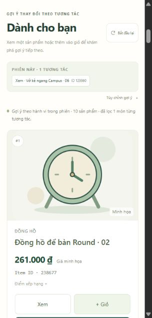

# Ví dụ thật để trình bày: user 1000484

Ví dụ này được chọn để giải thích một dự đoán trúng, **không phải mẫu ngẫu
nhiên đại diện cho chất lượng toàn hệ thống**. Ngày 24/10/2026 đã tính lại từ
CSV trong ZIP và khớp hash cohort gốc, không dùng graph full để chấm tương lai.

Nguồn: [Retailrocket recommender system dataset trên Kaggle](https://www.kaggle.com/datasets/retailrocket/ecommerce-dataset),
giấy phép [CC BY-NC-SA 4.0](https://creativecommons.org/licenses/by-nc-sa/4.0/).
Data card công bố các giá trị đã được băm để bảo mật. Visitor ID ở đây là mã
trong bộ dữ liệu nghiên cứu công khai, không phải tài khoản của người dùng dự
án; không có tên, email hoặc IP. CSV trích xuất giữ nguyên hai dòng nguồn,
thêm `source_line` và sắp theo thời gian. Phần dữ liệu trích xuất kế thừa giấy
phép nguồn; ghi chú này không đặt lại giấy phép cho toàn bộ mã nguồn dự án.

## 1. Mở dữ liệu nguồn

User `1000484` có đúng hai dòng trong `events.csv`. Giờ Việt Nam ngày 04/09/2015:

| Thời gian | Hành vi | Item ID | Dòng CSV, tính cả header |
| --- | --- | ---: | ---: |
| 08:15:33.729 | view | 129960 | 1.206.214 |
| 08:16:35.000 | view | 75643 | 1.206.017 |

Hai lượt cách nhau **61,271 giây**, cùng phiên theo gap 30 phút. CSV gốc không
sắp thời gian hoàn toàn, nên số dòng không biểu thị thứ tự hành vi.
Xem [hai dòng trích xuất](../reports/examples/user_1000484/events_user_1000484.csv).
Tên/ảnh trên dashboard được gán minh họa; không thể kết luận hai ID này thực
sự là vở, ốp lưng hay hai sản phẩm cùng loại.

## 2. Đặt mình tại thời điểm dự đoán

Query `1000484:1441329333729` có context là **chỉ lượt xem 129960**.
`as_of=1441329394999`, ngay trước timestamp của lượt xem kế tiếp. Target thực
tế là `75643`; nó chưa nằm trong context.

Graph kiểm tra chỉ học **2.341.051 event** có timestamp ≤ `1440538554824`.
User này có **0 event trong train**. Hệ thống vẫn gợi ý được nhờ món vừa xem
và quan hệ học từ những user khác. Đây là user mới có context, khác với lần
truy cập hoàn toàn chưa có tương tác (khi đó dùng popularity).

## 3. Model đã dự đoán gì?

Top 10 tính lại bằng **công thức strength 75/25 hiện tại**, graph chỉ học train:

| Hạng | Item ID | Điểm | Trùng hành vi tương lai? |
| --- | ---: | ---: | --- |
| 1 | 238677 | 0,927631 | Không |
| 2 | 336437 | 0,894338 | Không |
| 3 | 375846 | 0,743284 | Không |
| 4 | 382552 | 0,716365 | Không |
| 5 | 35403 | 0,656578 | Không |
| 6 | 323328 | 0,656578 | Không |
| 7 | 191049 | 0,619087 | Không |
| 8 | 322051 | 0,619087 | Không |
| **9** | **75643** | **0,598947** | **Có** |
| 10 | 313931 | 0,598947 | Không |

ID `129960` bị loại vì đã xem. Hòa điểm thì ID tăng dần. Popularity trên cùng
truy vấn không có `75643` trong Top 10. Bản RRF liền trước cũng không có nó
trong Top 10 của ví dụ này. Đây chỉ là đối chiếu một trường hợp; so sánh toàn
hệ thống phải đọc báo cáo 5.000 query.

Với riêng query có một target này: Precision@10 = **10%**, Recall@10 = **100%**,
NDCG@10 = `1/log2(10)` ≈ **30,103%**. Không lấy số này thay cho chỉ số toàn bộ
tập kiểm tra **4,148% / 28,2803% / 19,7041%**.

## 4. Vì sao lại chọn 75643?

Sau khi mỗi user chỉ giữ tối đa 20 ID phân biệt gần nhất, graph train có:

- 58 user có ID `129960`.
- 16 user có ID `75643`.
- 5 user có cả hai ID.

```text
co_score = (5/58) × (5/(5+3)) = 0,05387931
max_co_score của seed 129960 = 0,08448276
đóng góp item-item = 0,75 × sqrt(0,05387931 / 0,08448276)
                    = 0,59894678
```

Trong train không có cạnh chuyển tiếp được giữ cho `129960 → 75643`, nên nhánh
chuyển tiếp đóng góp **0**. Món này vẫn vào Top 10 nhờ item-item. Điểm 0,5989
là điểm xếp hạng, không phải xác suất mua 59,89%.

Ví dụ ID `238677` đứng đầu vì vừa có 6 user đồng tương tác, vừa có 3 lần
chuyển tiếp từ seed; tổng đóng góp là `0,67763093 + 0,25 = 0,92763093`.
Số đếm, cạnh và từng thành phần điểm đều có trong
[bằng chứng JSON](../reports/examples/user_1000484/real-example.json).

## 5. Thao tác trên dashboard khi trình bày

1. Mở cửa hàng, vào **Dành cho bạn**, bấm **Bắt đầu lại** nếu đang có context.
2. Trong **Tùy chỉnh gợi ý**, để Visitor ID trống và số lượng là 10.
3. Mở **Thử bằng Item ID**, nhập `129960`, chọn **Xem sản phẩm**, bấm
   **Ghi nhận & cập nhật**.
4. Chờ dòng trạng thái đổi thành **Gợi ý theo hành vi trong phiên**. Snapshot
   full hiện tại trả đầu danh sách `238677, 336437, 75643, 407489, ...`.
   ID `129960` không xuất hiện lại.
5. Mở **Chi tiết yêu cầu gần nhất** để chỉ ra context, ID và nguồn gợi ý.
6. Khi giải thích độ đúng lịch sử, mở bảng ở mục 3 và hai dòng CSV, nói rõ:
   **graph train xếp 75643 thứ 9; graph full trên dashboard xếp thứ 3**.

Dashboard dùng graph đã học cả lịch sử, gồm cả các hành vi kiểm tra năm 2015.
Vì vậy vị trí thứ 3 **chỉ minh họa suy luận**, không phải bằng chứng dự đoán
chưa thấy. Bằng chứng dự đoán là lần tái tạo graph trước cutoff ở trên.

Nếu nhập Visitor ID `1000484`, API biết cả `129960` và `75643` trong SQLite
lịch sử đầy đủ và lọc cả hai. Việc không trả `75643` lúc đó là đúng luật lọc,
không phải model bị lỗi. Mô phỏng trong tab không sửa dữ liệu nguồn.



## 6. Đoạn nói mẫu khoảng 45 giây

> Em lấy một người dùng thật trong RetailRocket. Người này xem ID 129960,
> khoảng một phút sau xem ID 75643. Khi kiểm tra, model chỉ được học dữ liệu
> trước cutoff và chỉ nhìn thấy món đầu trong phiên. Từ hành vi của người
> khác, model đưa 75643 vào vị trí thứ 9 của danh sách 10 món, nên đây là một
> dự đoán trúng. Model học quan hệ giữa các ID, còn tên và ảnh là minh họa.
> Trên dashboard, model được học lại toàn lịch sử nên thứ hạng có thể khác;
> em dùng kết quả graph train để chứng minh dự đoán, không dùng graph full
> chấm lại quá khứ. Chất lượng chung được đánh giá trên 5.000 truy vấn.

## 7. Tự tính lại từ ZIP và mã GitHub

Script [report_real_example.py](../scripts/report_real_example.py) không cần
những thư mục thí nghiệm cũ đã bỏ khỏi ZIP. Nó dùng CSV, bundle, cutoff và
hash cohort được đóng gói, tạo graph train tạm trong bộ nhớ, không sửa serving.
Sau khi tải ZIP và clone repository mới, trong PowerShell tại repository:

```powershell
$repoRoot = (Get-Location).Path
$demoRoot = 'D:\BIGDATA\zip-check-20261024\big_data_update_2'
docker build -t retailrocket-report-check:local $demoRoot
docker run --rm --network none `
  --mount "type=bind,source=$repoRoot,target=/review" `
  --mount "type=bind,source=$demoRoot\data,target=/app/data,readonly" `
  --mount "type=bind,source=$demoRoot\outputs,target=/app/outputs,readonly" `
  -e PYTHONPATH=/review -w /review retailrocket-report-check:local `
  python -m scripts.report_real_example --project-root /app `
  --output /review/reports/examples/user_1000484/real-example.json
```

Thay `$demoRoot` bằng thư mục giải nén thực tế. NumPy/SciPy đã nằm trong image;
lần dựng image đầu cần Internet. Script dừng nếu CSV/cohort không khớp, graph
chưa đứng trước target, context không có trong CSV, điểm phân rã không khớp
hoặc kết quả có ID đã thấy/trùng lặp. Không chấm lại cả bộ metrics lịch sử.
